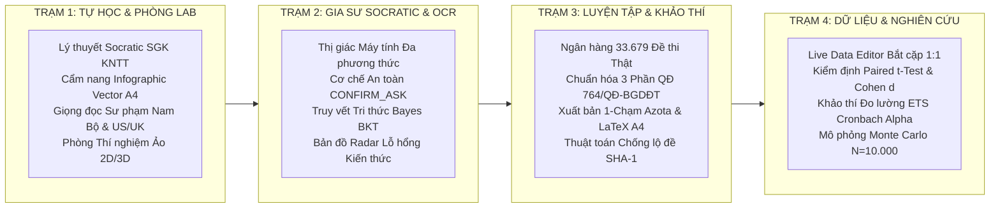

> **Bản vá kiểm thử 24/10/2026:** xem [QA_LIVE_20261024.md](QA_LIVE_20261024.md) để biết phạm vi đã kiểm tra, lỗi đã sửa và giới hạn còn lại. Dữ liệu mô phỏng được tách khỏi quan sát thật; các số lượng trong kho là bản ghi đề/lượt câu, chưa phải số câu độc nhất đã thẩm định. API Key cá nhân hỗ trợ danh sách cách nhau bằng dấu phẩy và không được đưa vào mã nguồn. `ADMIN_PASS` trong Streamlit Secrets có quyền ưu tiên thay mật khẩu demo đã được chủ dự án chỉ định.

# 🏫 GIA SƯ AI - HỆ SINH THÁI HỖ TRỢ TỰ HỌC VÀ CÁ NHÂN HÓA GIÁO DỤC TRUNG HỌC

> **Đề tài Nghiên cứu Khoa học Kỹ thuật (KHKT) Dành Cho Học Sinh Trung Học Năm 2026**  
> *Đơn vị nghiên cứu: Trường THPT Tân Hiệp (An Giang)*  
> *Tác giả & Chủ nhiệm đề tài: **Thầy Phan Minh Trí** (Trường THPT Tân Hiệp)*  
> *Thông điệp cốt lõi: **"Dưỡng thiện tâm - Ươm nhân tài • Khơi dậy năng lực tự học bằng công nghệ AI sư phạm"***  
> *Phạm vi đồng hành: Học sinh từ **Lớp 6 đến Lớp 12** • **13 môn học** theo Chương trình GDPT 2018 • Bám sát Bộ sách Kết Nối Tri Thức Với Cuộc Sống (NXB Giáo Dục Việt Nam)*  
> *Căn cứ pháp lý & khảo thí: Quyết định 764/QĐ-BGDĐT, Thông tư 32/2018/TT-BGDĐT, Thông tư 13/2022/TT-BGDĐT, Thông tư 22/2021/TT-BGDĐT, Công văn 3175/BGDĐT-GDTrH*

---

## 🌐 ĐỊA CHỈ TRUY CẬP VÀ MÃ NGUỒN
- **Thư mục Dữ liệu & Tài liệu trên Google Drive:** [https://drive.google.com/drive/folders/1ZNIMbaxVSV7NBA3g6MS-Ob7_SbfeWHtv?usp=sharing](https://drive.google.com/drive/folders/1ZNIMbaxVSV7NBA3g6MS-Ob7_SbfeWHtv?usp=sharing)

- **Web App Trực Tuyến (PWA Đa Nền Tảng):** [https://gsaithptth-khkt2026.streamlit.app](https://gsaithptth-khkt2026.streamlit.app)
- **Kho Mã Nguồn GitHub:** [https://github.com/pmtgiaitichk15khkt01-cmd/VIP_DEMO_GSAITHPT2026](https://github.com/pmtgiaitichk15khkt01-cmd/VIP_DEMO_GSAITHPT2026)
- **Tài Liệu Hướng Dẫn & Thuyết Minh KHKT:** `HUONG_DAN_CAI_DAT_VA_SU_DUNG_GSAI_2026.pdf` *(Chuẩn in ấn A4)*

---

## 🌿 TRIẾT LÝ SƯ PHẠM & CHUẨN ĐẠO ĐỨC CỦA ĐỀ TÀI

### 1. Triết Lý "Dưỡng Thiện Tâm - Ươm Nhân Tài"
Hệ sinh thái Gia Sư AI (GSAI) được xây dựng từ tình yêu thương học trò và trăn trở về việc thu hẹp khoảng cách giáo dục giữa các vùng miền. Mục tiêu lớn nhất của đề tài không phải là tạo ra một công cụ phô diễn công nghệ, mà là một **người thầy AI đồng hành ân cần, kiên nhẫn**, khơi dậy niềm đam mê học tập tự thân và bồi dưỡng phẩm chất nhân văn cho từng học sinh.

### 2. Phương Pháp Luận Socratic & Tiến Trình 4 Bước George Polya
Nhằm triệt tiêu thói quen học vẹt và chống việc lạm dụng AI để giải bài tập hộ (Anti-Cheating by Design):
- **Không bao giờ giải bài hộ:** AI đóng vai trò người thầy dẫn dắt, chia nhỏ vấn đề thành các câu hỏi gợi mở nối tiếp theo nấc thang nhận thức Bloom.
- **Tiến trình 4 bước Polya:**
  1. *Bước 1 - Hiểu rõ bài toán:* Tự tay phân tích giả thiết, kết luận và mối liên hệ bản chất.
  2. *Bước 2 - Lập kế hoạch giải:* Xác định định lý, công thức và con đường tiếp cận logic.
  3. *Bước 3 - Thực hiện kế hoạch:* Tự mình tính toán, lập luận chặt chẽ từng bước.
  4. *Bước 4 - Nhìn lại và đúc rút:* Phát hiện bẫy câu hỏi, nhận diện lỗ hổng và rút ra bài học nhân cách sống.

### 3. Đạo Đức AI & Bảo Vệ Quyền Riêng Tư (UNESCO & Bộ GD&ĐT)
- **Ẩn danh hóa dữ liệu (Anonymization):** Hệ thống không thu thập thông tin định danh cá nhân nhạy cảm (PII). Học sinh tham gia khảo sát được mã hóa bằng mã số học tập nội bộ.
- **Bảo mật lưu trữ phía người dùng (Client-Side Storage):** Bản nháp có thể được lưu trên thiết bị. Streamlit xử lý dữ liệu phía máy chủ; yêu cầu AI được gửi đến Gemini, nhật ký có thể được lưu vào SQLite và đồng bộ theo cấu hình. Cần thông báo luồng dữ liệu và quyền truy cập cho người dùng.
- **Minh bạch mã nguồn & Thuật toán khoa học:** Toàn bộ công thức thống kê thực nghiệm (Paired $t$-Test, Cohen's $d$, Pearson $r$, Monte Carlo Simulation) được công khai minh bạch phục vụ công tác thẩm định khoa học.

---

## 🏛️ KIẾN TRÚC 4 TRẠM TƯƠNG TÁC SƯ PHẠM

Hệ thống tổ chức tiến trình học tập khép kín qua mô hình 4 Trạm chức năng tương tác:



---

### 📖 TRẠM 1: TỰ HỌC, GIỌNG ĐỌC SƯ PHẠM & PHÒNG LAB VIRTUAL
- **Bám sát Chương trình GDPT 2018 & Sách giáo khoa Kết Nối Tri Thức:** Tích hợp trực tiếp danh mục bài học từ Lớp 6 đến Lớp 12 cho toàn bộ các môn học; tra cứu liên kết SGK điện tử chính thống từ NXB Giáo Dục Việt Nam.
- **Cẩm nang Tóm tắt Infographic Vector SVG A4:** Tự động tổng hợp bài học thành sơ đồ tư duy dạng phiếu học tập chuẩn A4 gồm 4 khối kiến thức chuẩn mực (Khái niệm cốt lõi, Công thức quy luật, Tiến trình 4 bước Polya, Cạm bẫy thường gặp). Cung cấp cả bản Màu điện tử và bản Đơn sắc thân thiện cho việc in ấn trên giấy A4.
- **Thuyết minh Sư phạm Đa ngữ điệu (Web Speech API):**
  * *Các môn tiếng Việt / Khoa học:* Giọng đọc Nam Bộ / tiếng Việt chuẩn mực, tốc độ $0.88\times$ từ tốn, phát âm chính xác các ký hiệu toán học ($\int, \frac{a}{b}, \sqrt{x}, \vec{u}$) và danh pháp quốc tế IUPAC.
  * *Môn Tiếng Anh:* Tự động kích hoạt giọng bản ngữ chuẩn US/UK phục vụ luyện nghe và phát âm.
- **Phòng Thí nghiệm Ảo 2D/3D (Plotly):** Trực quan hóa tương tác mô hình phân tử Hóa học 3D, sóng dừng Vật lý, không gian tọa độ $Oxyz$ Toán học và mặt cong giải tích.

---

### ✍️ TRẠM 2: GIA SƯ SOCRATIC & THỊ GIÁC ĐA PHƯƠNG THỨC OCR
- **Nhận diện Thị giác Máy tính Đa trang:** Hỗ trợ chụp trực tiếp nhiều trang vở qua Camera thiết bị hoặc tải tệp ảnh (PNG, JPG, WEBP, HEIC/HEIF).
- **Cơ chế An toàn `<CONFIRM_ASK>` Chống Ảo giác:** Khi ảnh chụp bài làm bị mờ, mất nét hoặc công thức bị che khuất, AI chủ động phát thẻ xác nhận để đối thoại làm rõ với học sinh, tuyệt đối không suy đoán tùy tiện.
- **Bút tích Mực đỏ Sư phạm:** Trích xuất tọa độ lỗi sai và hiển thị trực quan các vị trí đạt chuẩn (Tick xanh OK) cùng vị trí cần lưu ý (Mực đỏ Check VAR) trên chính bài làm của học sinh.
- **Bản đồ Radar Lỗ hổng Tri thức:** Tự động phân tích điểm yếu theo 5 trục năng lực của Thông tư 22/2021/TT-BGDĐT để định hướng bài tập củng cố tương ứng.

---

### 📝 TRẠM 3: LUYỆN TẬP & KHẢO THÍ CHUẨN QUỐC GIA (QĐ 764/QĐ-BGDĐT)
- **Quy mô Ngân hàng Khảo thí Đa môn:** Lưu trữ và chỉ mục hơn **33.679 đề thi thật** (gần 1 triệu lượt câu hỏi; có nội dung lặp và biến thể) từ các trường THPT điểm và Sở GD&ĐT trên 64 tỉnh thành.
- **Cấu trúc Đề thi Chuẩn Hóa Theo Quyết định 764/QĐ-BGDĐT:**
  * *Phần I:* Câu trắc nghiệm nhiều phương án lựa chọn (4 chọn 1).
  * *Phần II:* Câu trắc nghiệm Đúng/Sai với thang điểm lũy tiến quy định (Đúng 1 ý = 0.1đ; Đúng 2 ý = 0.25đ; Đúng 3 ý = 0.5đ; Đúng 4 ý = 1.0đ).
  * *Phần III:* Câu trắc nghiệm trả lời ngắn có xét dung sai làm tròn số học thực nghiệm ($\pm 0.015$).
  * *Môn Ngữ văn:* Đổi mới toàn diện theo Công văn 3175/BGDĐT-GDTrH với **100% ngữ liệu mới ngoài SGK**, chấm theo barem Đọc hiểu (4.0đ) và Viết (6.0đ).
- **Hai Phân Hệ Vận Hành:**
  * *Chế độ Thí sinh:* Tùy biến ma trận kiến thức theo khối lớp, thi thử tính giờ, phòng thi có đồng hồ đếm ngược, thuật toán băm SHA-1 chống lặp lại đề cũ.
  * *Chế độ Giáo viên:* Tải tệp đề thi Word (`.docx`) hoặc PDF để bóc tách tự động, hòa trộn đề thi tỉ lệ 50/50 với ngân hàng chuẩn quốc gia, lưu trữ kho đề riêng hoặc đóng góp vào ngân hàng đề chung.
- **Xưởng Xuất Bản 1-Chạm:**
  * Xuất bản đề thi chuẩn nhận diện tự động cho hệ thống **Azota / LMS Quốc gia** (bọc toàn bộ công thức inline `$..$` thành `$$..$$` và sinh bảng đáp án tự động).
  * Xuất bản mã nguồn **LaTeX Overleaf chuẩn A4** và tệp tài liệu Word phục vụ in ấn phát đề trên giấy.
  * Tạo mã **QR Code** chia sẻ đề thi nhanh chóng đến học sinh.

---

### 📊 TRẠM 4: DỮ LIỆU THỰC NGHIỆM SƯ PHẠM & KIỂM ĐỊNH KHOA HỌC (APA 7th)
- **Đa Dạng Nguồn Thu Thập:** Kết nối trực tiếp CSDL SQLite nội bộ, bảng nhập điểm trực tiếp Live Data Editor, nhập từ tệp CSV/Excel hoặc đồng bộ từ nhật ký thi thực tế của Trạm 3.
- **Phương Pháp Luận Nghiên Cứu Bắt Cặp 1:1:** Đối chiếu kết quả trước can thiệp (Pre-test) và sau can thiệp (Post-test) của từng học sinh, so sánh giữa nhóm can thiệp GSAI và nhóm đối chứng truyền thống.
- **Quy Chuẩn Thống Kê Theo Chuẩn Mực Khoa Học APA 7th:**
  * *Kiểm định Phân phối Chuẩn Shapiro-Wilk:* Xác lập tính chất phân phối của dữ liệu trước khi chọn kiểm định phù hợp.
  * *Kiểm định Paired Samples $t$-Test & Wilcoxon:* Đo lường ý nghĩa thống kê của mức độ tăng trưởng điểm số ($p < 0.001$).
  * *Kích thước Hiệu ứng Cohen's $d_z$:* Xác định mức độ can thiệp thực tế ($d > 0.8$ ở mức tác động lớn).
  * *Chỉ số Tăng trưởng Chuẩn hóa Hake's Gain $\langle g \rangle$:* Đo lường hiệu quả học tập thực chất loại trừ ảnh hưởng của điểm xuất phát ban đầu.
- **Phân Tích Liều Lượng Thời Gian Tự Học Lành Mạnh:** Khảo sát mối tương quan Pearson ($r$) giữa thời gian học và độ tăng điểm $\rightarrow$ Đưa ra khuyến nghị sư phạm: **Thời gian tự học tối ưu đạt 25 - 35 phút/ngày**, tránh lạm dụng thiết bị điện tử.
- **Mô Phỏng Mở Rộng Diện Rộng (Monte Carlo Simulation - $N = 10.000$):** Ứng dụng thuật toán ngẫu nhiên 10.000 lần lặp để dự báo xu thế hội tụ phổ điểm Gauss khi áp dụng mở rộng quy mô.

---

## 🔬 CÁC CÔNG NGHỆ CHUYÊN SÂU TÍCH HỢP TRONG ĐỀ TÀI

| Công nghệ tích hợp | Cơ sở khoa học & Chức năng sư phạm | Giá trị thực tiễn trong hệ thống |
| :--- | :--- | :--- |
| **Bayesian Knowledge Tracing (BKT)** | Mô hình xác suất Bayes (Corbett & Anderson, 1994) cập nhật liên tục xác suất làm chủ tri thức $P(L_t)$ qua từng bước tương tác Socratic. | Định lượng hóa sự tiến bộ nhận thức của học sinh; chứng minh tốc độ tiếp thu qua gợi mở cao hơn phương pháp đọc đáp án chép sẵn. |
| **Neuro-Symbolic Verifier (SymPy + LLM)** | Kết hợp giữa mô hình ngôn ngữ lớn và Trí tuệ Nhân tạo Biểu tượng toán học (Symbolic AI). | Kiểm chứng độc lập các bước tính đạo hàm, cực trị, tiệm cận, tích phân; hỗ trợ phát hiện một số lỗi trong phạm vi biểu thức được hỗ trợ; không bảo đảm loại bỏ mọi lỗi AI. |
| **FSRS Adaptive Spaced Repetition** | Mô hình thuật toán lặp ngắt quãng thích ứng dựa trên đường cong quên lãng Ebbinghaus. | Tính toán độ bền trí nhớ $S$ và xác định "Điểm rơi vàng ôn tập" (khi xác suất nhớ lại $R \approx 85\% - 90\%$) từ nhật ký sửa lỗi Trạm 2. |
| **Khảo Thí Đo Lường ETS (Psychometrics)** | Tiêu chuẩn đo lường khảo thí của Viện Khảo thí Giáo dục Hoa Kỳ (ETS). | Tự động tính hệ số tin cậy nội tại Cronbach's Alpha ($\alpha$) và hệ số phân biệt Point-Biserial ($r_{pbis}$) cho từng câu hỏi trong ngân hàng đề. |
| **Universal Precision Visual Engine** | Động cơ phục dựng thị giác học thuật độc lập. | Tái hiện bảng biến thiên chuẩn mực, đồ thị hàm số và sơ đồ khoa học chuẩn xác; có chốt chặn chống gán nhầm đồ thị Toán vào các môn khác. |
| **Công Nghệ Nén Sharded LZMA/XZ** | Chuẩn nén dữ liệu hiệu năng cao với thuật toán LZMA Preset 9. | Đóng gói toàn bộ kho đề thi khổng lồ của 13 môn học trong dung lượng tối ưu, nạp đề tức thì dưới 0.05 giây và chạy hoàn toàn ngoại tuyến (0 Token). |

---

## 📚 DANH MỤC 13 MÔN HỌC & 7 KHỐI LỚP (FULL CT GDPT 2018)

Hệ thống được thiết kế mở rộng hoàn chỉnh, đáp ứng khung chương trình giáo dục phổ thông hiện hành:

| Cấp học | Khối lớp | Danh mục các môn học tích hợp chuẩn CT GDPT 2018 |
| :--- | :--- | :--- |
| **THCS** | **Lớp 6, 7, 8, 9** | • Toán học<br>• Khoa học tự nhiên (Tích hợp Vật lý, Hóa học, Sinh học)<br>• Ngữ văn *(100% ngữ liệu mới ngoài SGK)*<br>• Tiếng Anh *(Khung năng lực ngoại ngữ 6 bậc / CEFR)*<br>• Lịch sử &amp; Địa lý<br>• Tin học<br>• Giáo dục công dân<br>• Công nghệ *(Nông nghiệp, Cơ khí, Điện tử)* |
| **THPT** | **Lớp 10, 11, 12** | • Toán học *(Hàm bậc ba, Phân thức 1/1, Phân thức 2/1, Parabol, Hình học không gian Oxyz)*<br>• Vật lý<br>• Hóa học *(100% Danh pháp quốc tế IUPAC: Alkane, Alcohol, Ester...)*<br>• Sinh học *(Di truyền phân tử, Quần thể, Sinh thái học)*<br>• Ngữ văn *(Ma trận Đọc hiểu &amp; Nghị luận chuẩn mực 2026)*<br>• Tiếng Anh *(Luyện phát âm &amp; Kỹ năng đọc hiểu chuyên sâu)*<br>• Lịch sử<br>• Địa lý<br>• Tin học *(Lập trình Python, Cấu trúc dữ liệu &amp; Khoa học máy tính)*<br>• Giáo dục kinh tế và pháp luật (GDKT-PL)<br>• Công nghệ *(Thiết kế kỹ thuật, Cơ khí chế tạo, Điện hạ áp)* |

---

## 🛠️ HƯỚNG DẪN CÀI ĐẶT & CHẠY THỬ NGHIỆM CỤC BỘ (LOCAL)

```bash
# 1. Tải kho mã nguồn từ GitHub
git clone https://github.com/pmtgiaitichk15khkt01-cmd/VIP_DEMO_GSAITHPT2026.git
cd VIP_DEMO_GSAITHPT2026

# 2. Cài đặt các gói thư viện phụ thuộc
pip install -r requirements.txt

# 3. Chạy bài kiểm toán toàn vẹn hệ thống (Deep Check VAR)
python deep_check_var_project.py

# 4. Khởi chạy ứng dụng Web Streamlit
streamlit run app.py
```

---

## 📱 CẨM NANG CÀI ĐẶT WEB APP BIỂU TƯỢNG (PWA)

GSAI hoạt động theo chuẩn **Progressive Web App (PWA)**, cho phép cài đặt trực tiếp biểu tượng độc lập trên màn hình chính của mọi thiết bị mà không cần qua kho ứng dụng trung gian:

1. **Trên thiết bị Android (Chrome / Cốc Cốc / Edge):**  
   Mở trình duyệt truy cập ứng dụng $\rightarrow$ Bấm nút menu **3 dấu chấm (⋮)** ở góc trên bên phải $\rightarrow$ Chọn **"Thêm vào Màn hình chính"** *(hoặc "Cài đặt ứng dụng")*.
2. **Trên thiết bị iOS iPhone / iPad (Apple Safari):**  
   Mở Safari truy cập ứng dụng $\rightarrow$ Bấm biểu tượng **Chia sẻ (Share - ô vuông có mũi tên hướng lên ↑)** $\rightarrow$ Chọn **"Thêm vào MH chính" (Add to Home Screen)**.
3. **Trên Máy tính PC / Laptop (Google Chrome / Microsoft Edge):**  
   Truy cập đường dẫn ứng dụng $\rightarrow$ Bấm biểu tượng **Cài đặt ứng dụng (⊕)** ở góc phải thanh địa chỉ trình duyệt $\rightarrow$ Chọn **Cài đặt (Install)**.

---

## 🤝 THÔNG TIN DỰ ÁN & LỜI TRI ÂN

- **Tên đề tài:** *Hệ sinh thái Gia Sư AI hỗ trợ học sinh tự học và cá nhân hóa lộ trình giáo dục trung học theo Chương trình GDPT 2018.*
- **Đơn vị nghiên cứu:** Trường THPT Tân Hiệp (An Giang).
- **Tác giả & Chủ nhiệm đề tài:** Thầy Phan Minh Trí (Trường THPT Tân Hiệp).
- **Mục tiêu nghiên cứu:** Phục vụ Cuộc thi Khoa học Kỹ thuật (KHKT) Dành Cho Học Sinh Trung Học Năm 2026.
- **Lời tri ân:** Nhóm tác giả xin bày tỏ lòng biết ơn sâu sắc đến Ban Giám hiệu, quý thầy cô giáo bộ môn, các nhà khoa học giáo dục và các bạn học sinh đã tham gia trải nghiệm, đóng góp ý kiến quý báu để hoàn thiện hệ thống từng ngày.

*Dưỡng thiện tâm - Ươm nhân tài • Mỗi bước tiến của học sinh là niềm hạnh phúc lớn nhất của Người Thầy.*